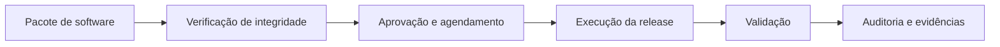
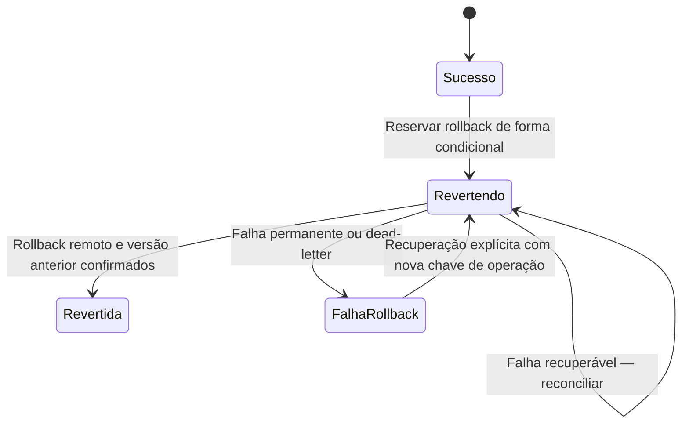

# ReleaseHub — showcase técnico

> Visão pública e sanitizada do produto. Este material não contém código-fonte, credenciais, dados de clientes ou configuração de produção.

## Visão geral

ReleaseHub é uma plataforma self-hosted para governar e executar releases de software em ambientes privados ou híbridos. O fluxo conecta pacote, aprovação, agendamento, execução, validação e auditoria.

[Acessar o ReleaseHub](https://releasehub.devforyou.com.br/) — o acesso às áreas operacionais requer uma conta autorizada.

## Desafio de produto

Coordenar mudanças de software exige contexto para a decisão, evidências de execução e uma forma clara de validar ou reverter uma release. O ReleaseHub organiza essas etapas em um fluxo rastreável.

## Minha contribuição

Sou responsável pelo desenho, pela arquitetura e pela construção do produto.

## Arquitetura em alto nível

- **Aplicação:** ASP.NET Core sobre .NET 10.
- **Execução:** self-hosted em Ubuntu Server, com Docker e Cloudflare Tunnel para ingresso.
- **Persistência:** SQL Server.
- **Fluxo:** catálogo e pacotes → aprovação e agendamento → execução → validação e auditoria.

## Integridade da cadeia de artefatos

As verificações incluem SHA-256 e políticas configuráveis para exigir assinatura, proveniência e SBOM antes da implantação. A validação registra o resultado para apoiar rastreabilidade e decisões de release.

## Recuperação de rollback

O rollback é tratado como uma saga com estado intermediário. A release é reservada como `Revertendo` antes do efeito remoto; só passa a `Revertida` depois que a versão anterior é confirmada no catálogo local. Falhas permanecem explícitas e podem ser reconciliadas ou recuperadas com uma nova operação idempotente.

O catálogo local só confirma a versão anterior após a confirmação remota; um rollback falho ou incerto não se transforma silenciosamente em uma release bem-sucedida.

## Escopo deste showcase

Este resumo apresenta capacidades em alto nível. Não publica código-fonte, detalhes de autenticação, endpoints operacionais, segredos, dados de clientes, topologia detalhada ou configuração operacional de ambientes.
